  <a href="./README.md">🇬🇧 English</a> · 🇪🇸 Español

  

  
  
  

  
  

  

## 👨‍💻 Sobre mí

Desarrollador backend con **más de 8 años** de experiencia construyendo aplicaciones con **Java**. Me apasionan el código limpio, los dominios bien modelados y la arquitectura pragmática, y siempre busco formas de mejorar y optimizar mi trabajo (y el de mi equipo).

- 🏢 **Senior Java Developer en [Inditex](https://www.inditex.com)**: desde hace un año en la vertical de **Platform Core Supply Chain (PCSC)**, apoyando en varios proyectos. Actualmente con **Java 25** y **Spring Framework 7**.
- 🎓 Desde **octubre de 2026** estudio un **Curso de Especialización en Inteligencia Artificial y Big Data**, para sumar datos y ML a mi caja de herramientas backend.
- 🌱 Desde **2026** **colaboro en proyectos open source** para aportar y aprender nuevas metodologías, además de los proyectos personales que mantengo.
- 🤖 **Usuario avanzado y consciente de la IA**: la uso como copiloto para desarrollar, organizarme y automatizar procesos del día a día. Me hace más rápido, pero reviso, pruebo y respondo de cada línea que subo.
- 🏛️ **Pragmático con la arquitectura**: Hexagonal, DDD, CQRS, diseño orientado a eventos, TDD y SOLID, y el patrón de diseño que cada problema necesite.

## 🤖 Cómo trabajo con IA

  

La IA forma parte de mi flujo de trabajo diario, no sustituye al criterio de ingeniería:

| Dónde me ayuda la IA | Lo que siempre hago yo |
|---|---|
| Explorar diseños y alternativas más rápido | Decisiones de arquitectura y de dominio |
| Scaffolding, boilerplate, casos de test y documentación | Leer y entender cada diff |
| Organizar tareas, notas y prioridades | Probar, refactorizar y revisar antes de cada commit / PR |
| Automatizar procesos repetitivos del día a día | Quality gates: CI, tests, análisis estático |

#### 🧰 Mis herramientas de IA

  
  
  

- **Agentes en la terminal**: trabajo normalmente con **Claude Code CLI** y **OpenCode CLI**.
- **Orca** como gestor de workspaces y sesiones de IA, para llevar varias tareas y contextos en paralelo sin perder el hilo.
- **Elección consciente del modelo**: me voy adaptando a los modelos que van saliendo y elijo el adecuado para cada tarea, equilibrando calidad y gasto de créditos: modelos ligeros para el trabajo rutinario y los más potentes para diseño complejo o depuración difícil.

## 🧭 Trayectoria

  

| Periodo | Empresa | Rol | Foco |
|---|---|---|---|
| 2024 → hoy | **Inditex** | Senior Java Developer | Microservicios orientados a eventos · plataforma de Supply Chain |
| 2023 – 2024 | **Diverger** | Senior Java Developer | Producto de gestión multi-cloud |
| 2021 – 2023 | **Hewlett Packard Enterprise** | Senior Backend Developer | Microservicios reactivos · observabilidad |
| 2020 – 2021 | **Nática** | Senior Backend Developer | Migración a microservicios · Java y .NET |
| 2019 – 2020 | **Atos** | Mid Backend Developer | Plataforma de sanidad pública |
| 2019 | **Coremain** | Junior Backend Developer | Educación pública · rendimiento SQL |
| 2018 – 2019 | **Altia** | Junior Backend Developer | Administración pública |

<b>🟠 Inditex</b> — Senior Java Developer · <i>may. 2024 – actualidad</i>

 

> **Equipo staff** de alto rendimiento que arranca proyectos desde cero, refuerza equipos con alta carga de trabajo y establece las bases técnicas sobre las que construyen los demás. Desde hace un año estoy en la vertical de **Platform Core Supply Chain (PCSC)**, apoyando en varios proyectos.

- Diseño y desarrollo de **microservicios orientados a eventos** con **arquitectura hexagonal, DDD, CQRS, TDD y SOLID**, aplicando los patrones de diseño que cada problema necesita (Transactional Outbox, Saga, Anti-Corruption Layer, Strategy, Factory…).
- **APIs REST** con **OpenAPI** (API-first), APIs de eventos **Kafka** con **Avro** y Schema Registry, Anti-Corruption Layers y Bounded Contexts.
- Participé en la **migración de la plataforma de Java 21 a Java 25** y a **Spring Framework 7**.
- Observabilidad desde el diseño: métricas y trazas con **Micrometer, OpenTelemetry y Prometheus**.
- Equipo autosuficiente: me encargo de las tareas de principio a fin, del análisis a producción.
- **Guardias de soporte semanales** del proyecto, atendiendo incidencias en producción.
- **Dominio avanzado de la IA como copiloto de desarrollo** (Claude Code / OpenCode CLI, Orca) para diseñar, programar, organizarme y automatizar procesos del día a día — siempre con supervisión humana: cada cambio pasa por mi propia revisión, tests y quality gates antes de cada commit / PR.

`Java 25` `Spring Framework 7` `Spring Boot` `Kafka` `Avro` `Schema Registry` `OpenAPI` `Karate` `MapStruct` `Lombok` `JUnit 5` `Mockito` `Instancio` `Micrometer` `OpenTelemetry` `Prometheus` `MongoDB` `PostgreSQL` `Docker` `GitHub`

<b>🟡 Diverger</b> — Senior Java Developer · <i>oct. 2023 – may. 2024</i>

 

> Producto propio de la empresa: una **única plataforma para gestionar recursos en AWS, Azure y Google Cloud**.

- Microservicios con **arquitectura hexagonal y DDD**, manteniendo la integración con cada proveedor cloud desacoplada y extensible mediante patrones de diseño.
- APIs **GraphQL** y tests de comportamiento con **Cucumber**.
- Responsable de parte del **pipeline CI/CD**: imágenes Docker, charts de Helm, pipelines de Jenkins y quality gates de Sonar, con despliegue en **Kubernetes**.

`Java 17` `Spring Boot 3` `Spring Cloud` `AWS` `Azure` `Google Cloud` `GraphQL` `Kubernetes` `Helm` `Jenkins` `Sonar` `MongoDB` `Cucumber` `Gradle`

<b>🔵 Hewlett Packard Enterprise</b> — Senior Backend Developer · <i>ago. 2021 – oct. 2023</i>

 

> **Microservicios reactivos y asíncronos** sobre Kubernetes, con mucho foco en testing y observabilidad.

- Servicios no bloqueantes con **Spring WebFlux** y arquitectura hexagonal; **BlockHound** para detectar llamadas bloqueantes en código reactivo.
- Orquestación de workflows de larga duración con **Temporal.io** y mensajería asíncrona con **Amazon SQS / SNS**.
- **TDD** en toda la pirámide de tests: unitarios, integración, e2e (Cucumber) y carga (**Gatling**).
- Trazas distribuidas y telemetría con **OpenTelemetry, Micrometer/Sleuth, Grafana y Logstash**.

`Java 17` `Spring WebFlux` `Spring Boot 3` `Spring Cloud` `Temporal.io` `Amazon SQS` `Amazon SNS` `OpenTelemetry` `Micrometer` `Grafana` `Gatling` `BlockHound` `MongoDB` `Kubernetes` `Helm` `Maven`

<b>🩷 Nática</b> — Senior Backend Developer · <i>jun. 2020 – ago. 2021</i>

 

> Dos productos y dos stacks en paralelo: **Java (Spring)** y **VB.NET (ASP.NET Web Forms)**.

- Participé en la **migración de una aplicación Java a microservicios**, a la vez que mantenía y estabilizaba código legacy.
- Trabajo cercano con el equipo funcional para convertir requisitos en análisis técnico, y después desarrollo y pruebas.
- Seguridad de servicios con **Spring Security** sobre Oracle y MongoDB, con CI en Jenkins.

`Java 11` `Spring Boot` `Spring Security` `Oracle` `MongoDB` `Jenkins` `JUnit 4` `ASP.NET Web Forms` `VB.NET` `SOAP` `jQuery`

<b>🟣 Atos</b> — Mid Backend Developer · <i>sep. 2019 – jun. 2020</i>

 

> **Plataforma de alta demanda para el sector sanitario público gallego**, con gran volumen de usuarios y operaciones.

- Amplio alcance funcional: facturación, albaranes, pedidos y contabilidad de almacén.
- **Integraciones SOAP** (Spring WS) con servicios públicos externos legacy y servicios internos.
- Análisis técnico de nuevas funcionalidades y tareas.

`Java 11` `Spring Boot 2` `Spring WS` `Spring Security` `Hibernate` `Jackson` `SOAP` `Dojo Toolkit` `Oracle` `Informix` `Maven`

<b>🟢 Coremain</b> — Junior Backend Developer · <i>abr. 2019 – sep. 2019</i>

 

> Proyectos de **educación pública gallega**.

- Desarrollo del sistema de **admisión en centros educativos** y de la plataforma de **premios extraordinarios**.
- Mucho trabajo de **rendimiento SQL**: optimización de consultas, procedimientos almacenados e informes con JasperReports.

`Java 8` `Spring` `Struts 2` `Oracle` `JasperReports` `SOAP` `Maven` `Tomcat` `Mercurial`

<b>🔷 Altia</b> — Junior Backend Developer · <i>sep. 2018 – abr. 2019</i>

 

> Proyectos para la **administración pública gallega**, donde empezó mi carrera profesional.

- Pasé rápidamente de tareas guiadas a trabajar de forma autónoma.
- Corrección de bugs, limpieza de code smells y documentación técnica.

`Java 8` `Spring` `JSF` `JSP` `Struts` `Informix` `jQuery`

## 🧩 Patrones de diseño y prácticas

No me caso con ningún patrón: uso el que el problema necesita. Estos son los que más aplico:

| Familia | Patrones |
|---|---|
| **Arquitectura** | Hexagonal (Puertos y Adaptadores) · DDD (Agregados, Bounded Contexts, Eventos de dominio) · CQRS · Orientado a eventos · Microservicios |
| **Sistemas distribuidos** | Transactional Outbox · Saga · Anti-Corruption Layer · Consumidor idempotente · Retry y Circuit Breaker · API-first |
| **Creacionales** | Factory Method · Abstract Factory · Builder · Singleton · Prototype |
| **Estructurales** | Adapter · Facade · Decorator · Proxy · Composite · Bridge |
| **De comportamiento** | Strategy · Template Method · Observer · Command · Chain of Responsibility · State · Specification |
| **Prácticas** | TDD · SOLID · Clean Code · Code review · Observabilidad desde el diseño |

## 🛠️ Tecnologías

  <b>Backend</b> 
  
    
  <b>Datos</b> 
  
    
  <b>Cloud y DevOps</b> 
  
    
  <b>Observabilidad</b> 
  
    
  <b>🎓 Aprendiendo ahora — IA y Big Data</b> 
  

  
  
  
  
  
  
  
  

## 🌱 Open source y proyectos personales

Desde **2026** colaboro en **proyectos open source**, para devolver algo a las herramientas que uso a diario y aprender nuevas metodologías de otros equipos y comunidades. Lo combino con los **proyectos personales** que sigo manteniendo, que son mi campo de pruebas para nuevas tecnologías y enfoques.

## 🎮 Cómo empezó todo

Antes de programar profesionalmente ya estaba entregando software a miles de personas. Entre **2015 y 2018**, mientras estudiaba programación, lideré el desarrollo técnico de **Los Santos RP**, una comunidad de rol de GTA:

- **GTA San Andreas (SA:MP)** — modos de juego a medida en **PAWN** (un lenguaje basado en C): **más de 200.000 líneas de código**, hasta **1.000 jugadores simultáneos**, misiones y sistemas económicos completos.
- **GTA V (GT:MP)** — lógica de servidor en **C#** y scripts de cliente en **JavaScript**, arquitectura cliente-servidor para una comunidad de **más de 60.000 usuarios registrados**, eventos en tiempo real e integración con APIs externas.

Ahí empezó mi obsesión por el rendimiento, la escalabilidad y el buen diseño. 🚀

## 📊 Actividad en GitHub

  
  

  <picture>
    <source media="(prefers-color-scheme: dark)" srcset="https://raw.githubusercontent.com/SamuelAdigos/SamuelAdigos/output/github-snake-dark.svg"/>
    <source media="(prefers-color-scheme: light)" srcset="https://raw.githubusercontent.com/SamuelAdigos/SamuelAdigos/output/github-snake.svg"/>
    
  </picture>

## 📫 Hablemos

Abierto a retos backend interesantes, sistemas orientados a eventos, colaboraciones open source y cualquier cosa donde **Java se encuentre con la IA y los datos**.
Escríbeme a **[svila.smr@gmail.com](mailto:svila.smr@gmail.com)** o conecta conmigo en **[LinkedIn](https://www.linkedin.com/in/samuel-vr/)**.

  

