  🇬🇧 English · <a href="./README.es.md">🇪🇸 Español</a>

  

  
  
  

  
  

  

## 👨‍💻 About me

Backend developer with **8+ years** building applications with **Java**. I love clean code, well-modelled domains and pragmatic architecture — and I'm always looking for ways to improve and optimise how I (and my team) work.

- 🏢 **Senior Java Developer at [Inditex](https://www.inditex.com)** — for the past year in the **Platform Core Supply Chain (PCSC)** vertical, helping across several projects. Currently on **Java 25** and **Spring Framework 7**.
- 🎓 Since **October 2026** I'm studying a **Specialization Course in Artificial Intelligence & Big Data** — bringing data and ML into my backend toolbox.
- 🌱 Since **2026** I've been **contributing to open-source projects** to give back and learn new ways of working, alongside the personal projects I maintain.
- 🤖 **Heavy, deliberate AI user**: AI is my copilot to develop, organise my work and automate day-to-day processes. It makes me faster — I still review, test and own every line I commit.
- 🏛️ **Pragmatic about architecture**: Hexagonal, DDD, CQRS, event-driven design, TDD and SOLID — and whichever design pattern the problem actually calls for.

## 🤖 How I work with AI

  

AI is part of my everyday workflow, not a replacement for engineering judgement:

| Where AI helps me | What always stays with me |
|---|---|
| Exploring designs and alternatives faster | Architecture & domain decisions |
| Scaffolding, boilerplate, test cases and docs | Reading and understanding every diff |
| Organising tasks, notes and priorities | Testing, refactoring and code review before each commit / PR |
| Automating repetitive day-to-day processes | Quality gates: CI, tests, static analysis |

#### 🧰 My AI toolkit

  
  
  

- **Agents in the terminal** — I mostly work with **Claude Code CLI** and **OpenCode CLI**.
- **Orca** as my manager for AI workspaces and sessions, so I can keep several tasks and contexts running in parallel without losing track.
- **Model-aware** — I keep up with new models as they're released and pick the right one for each task, balancing quality against credit spend: lighter models for routine work, top-tier ones for complex design or tricky debugging.

## 🧭 Career path

  

| Period | Company | Role | Focus |
|---|---|---|---|
| 2024 → now | **Inditex** | Senior Java Developer | Event-driven microservices · Supply Chain platform |
| 2023 – 2024 | **Diverger** | Senior Java Developer | Multi-cloud management product |
| 2021 – 2023 | **Hewlett Packard Enterprise** | Senior Backend Developer | Reactive microservices · observability |
| 2020 – 2021 | **Nática** | Senior Backend Developer | Microservices migration · Java & .NET |
| 2019 – 2020 | **Atos** | Mid Backend Developer | Public healthcare platform |
| 2019 | **Coremain** | Junior Backend Developer | Public education · SQL performance |
| 2018 – 2019 | **Altia** | Junior Backend Developer | Public administration |

<b>🟠 Inditex</b> — Senior Java Developer · <i>May 2024 – present</i>

 

> High-performance **staff team** that kicks off projects from scratch, reinforces teams with high workload and sets the technical foundations others build on. For the past year I've been in the **Platform Core Supply Chain (PCSC)** vertical, helping across several projects.

- Design and development of **event-driven microservices** with **Hexagonal architecture, DDD, CQRS, TDD and SOLID**, applying whichever design patterns each problem needs (Transactional Outbox, Saga, Anti-Corruption Layer, Strategy, Factory…).
- **REST APIs** with **OpenAPI** (API-first), **Kafka** event APIs with **Avro** & Schema Registry, Anti-Corruption Layers and Bounded Contexts.
- Took part in the **platform upgrade from Java 21 to Java 25** and **Spring Framework 7**.
- Observability by design: metrics and tracing with **Micrometer, OpenTelemetry and Prometheus**.
- Self-sufficient team: I own tasks end-to-end, from analysis to production.
- **Advanced use of AI as a development copilot** (Claude Code / OpenCode CLI, Orca) to design, code, organise my work and automate day-to-day processes — always with a human in the loop: every change goes through my own review, tests and quality gates before each commit / PR.

`Java 25` `Spring Framework 7` `Spring Boot` `Kafka` `Avro` `Schema Registry` `OpenAPI` `Karate` `MapStruct` `Lombok` `JUnit 5` `Mockito` `Instancio` `Micrometer` `OpenTelemetry` `Prometheus` `MongoDB` `PostgreSQL` `Docker` `GitHub`

<b>🟡 Diverger</b> — Senior Java Developer · <i>Oct 2023 – May 2024</i>

 

> Consultancy's own product: a **single platform to manage resources across AWS, Azure and Google Cloud**.

- Built microservices with **Hexagonal architecture and DDD**, keeping each cloud-provider integration decoupled and extensible through design patterns.
- **GraphQL** APIs and behaviour-driven tests with **Cucumber**.
- Owned part of the **CI/CD pipeline**: Docker images, Helm charts, Jenkins pipelines and Sonar quality gates, deploying on **Kubernetes**.

`Java 17` `Spring Boot 3` `Spring Cloud` `AWS` `Azure` `Google Cloud` `GraphQL` `Kubernetes` `Helm` `Jenkins` `Sonar` `MongoDB` `Cucumber` `Gradle`

<b>🔵 Hewlett Packard Enterprise</b> — Senior Backend Developer · <i>Aug 2021 – Oct 2023</i>

 

> **Reactive, asynchronous microservices** on Kubernetes, with a strong focus on testing and observability.

- Non-blocking services with **Spring WebFlux** and Hexagonal architecture; **BlockHound** to catch blocking calls in reactive code.
- Long-running workflow orchestration with **Temporal.io** and async messaging over **Amazon SQS / SNS**.
- **TDD** across the whole test pyramid: unit, integration, e2e (Cucumber) and load tests (**Gatling**).
- Distributed tracing and telemetry with **OpenTelemetry, Micrometer/Sleuth, Grafana and Logstash**.

`Java 17` `Spring WebFlux` `Spring Boot 3` `Spring Cloud` `Temporal.io` `Amazon SQS` `Amazon SNS` `OpenTelemetry` `Micrometer` `Grafana` `Gatling` `BlockHound` `MongoDB` `Kubernetes` `Helm` `Maven`

<b>🩷 Nática</b> — Senior Backend Developer · <i>Jun 2020 – Aug 2021</i>

 

> Two products, two stacks in parallel: **Java (Spring)** and **VB.NET (ASP.NET Web Forms)**.

- Took part in the **migration of a Java application to microservices**, while maintaining and stabilising legacy code.
- Worked closely with the functional team to turn requirements into technical analysis, then developed and tested the solution.
- Secured services with **Spring Security** on top of Oracle and MongoDB, with CI on Jenkins.

`Java 11` `Spring Boot` `Spring Security` `Oracle` `MongoDB` `Jenkins` `JUnit 4` `ASP.NET Web Forms` `VB.NET` `SOAP` `jQuery`

<b>🟣 Atos</b> — Mid Backend Developer · <i>Sep 2019 – Jun 2020</i>

 

> **High-demand platform for the Galician public healthcare sector**, with a large number of users and operations.

- Wide functional scope: invoicing, delivery notes, purchase orders and warehouse accounting.
- **SOAP integrations** (Spring WS) with legacy external public services and internal services.
- Technical analysis of new features and tasks.

`Java 11` `Spring Boot 2` `Spring WS` `Spring Security` `Hibernate` `Jackson` `SOAP` `Dojo Toolkit` `Oracle` `Informix` `Maven`

<b>🟢 Coremain</b> — Junior Backend Developer · <i>Apr 2019 – Sep 2019</i>

 

> Projects for **Galician public education**.

- Development of the **school admissions** system and the **extraordinary awards** platform.
- Lots of **SQL performance work**: query tuning, stored procedures and reports with JasperReports.

`Java 8` `Spring` `Struts 2` `Oracle` `JasperReports` `SOAP` `Maven` `Tomcat` `Mercurial`

<b>🔷 Altia</b> — Junior Backend Developer · <i>Sep 2018 – Apr 2019</i>

 

> Projects for the **Galician public administration** — where my professional career started.

- Grew quickly from guided tasks to working autonomously.
- Bug fixing, code-smell clean-up and technical documentation.

`Java 8` `Spring` `JSF` `JSP` `Struts` `Informix` `jQuery`

## 🧩 Design patterns & practices

I don't marry a pattern — I pick the one the problem calls for. These are the ones I use most often:

| Family | Patterns |
|---|---|
| **Architecture** | Hexagonal (Ports & Adapters) · DDD (Aggregates, Bounded Contexts, Domain Events) · CQRS · Event-Driven · Microservices |
| **Distributed systems** | Transactional Outbox · Saga · Anti-Corruption Layer · Idempotent Consumer · Retry & Circuit Breaker · API-first |
| **Creational** | Factory Method · Abstract Factory · Builder · Singleton · Prototype |
| **Structural** | Adapter · Facade · Decorator · Proxy · Composite · Bridge |
| **Behavioural** | Strategy · Template Method · Observer · Command · Chain of Responsibility · State · Specification |
| **Practices** | TDD · SOLID · Clean Code · Code review · Observability by design |

## 🛠️ Tech stack

  <b>Backend</b> 
  
    
  <b>Data</b> 
  
    
  <b>Cloud & DevOps</b> 
  
    
  <b>Observability</b> 
  
    
  <b>🎓 Currently learning — AI & Big Data</b> 
  

  
  
  
  
  
  
  
  

## 🌱 Open source & side projects

Since **2026** I've been contributing to **open-source projects** — to give something back to the tools I use every day and to learn new methodologies from other teams and communities. I combine it with the **personal projects** I keep maintaining, which are my playground for new technologies and approaches.

## 🎮 Origin story

Before coding professionally, I was already shipping software to thousands of people. From **2015 to 2018**, while studying programming, I led the technical development of **Los Santos RP**, a GTA roleplay community:

- **GTA San Andreas (SA:MP)** — custom game modes in **PAWN** (a C-like language): **200,000+ lines of code**, up to **1,000 concurrent players**, missions and full in-game economic systems.
- **GTA V (GT:MP)** — server logic in **C#** and client scripts in **JavaScript**, client-server architecture serving a community of **60,000+ registered users**, real-time events and external API integrations.

That's where my obsession with performance, scalability and clean design started. 🚀

## 📊 GitHub activity

  
  

  <picture>
    <source media="(prefers-color-scheme: dark)" srcset="https://raw.githubusercontent.com/SamuelAdigos/SamuelAdigos/output/github-snake-dark.svg"/>
    <source media="(prefers-color-scheme: light)" srcset="https://raw.githubusercontent.com/SamuelAdigos/SamuelAdigos/output/github-snake.svg"/>
    
  </picture>

## 📫 Let's talk

Open to interesting backend challenges, event-driven systems, open-source collaborations and anything where **Java meets AI & data**.
Drop me a line at **[svila.smr@gmail.com](mailto:svila.smr@gmail.com)** or connect on **[LinkedIn](https://www.linkedin.com/in/samuel-vr/)**.

  

